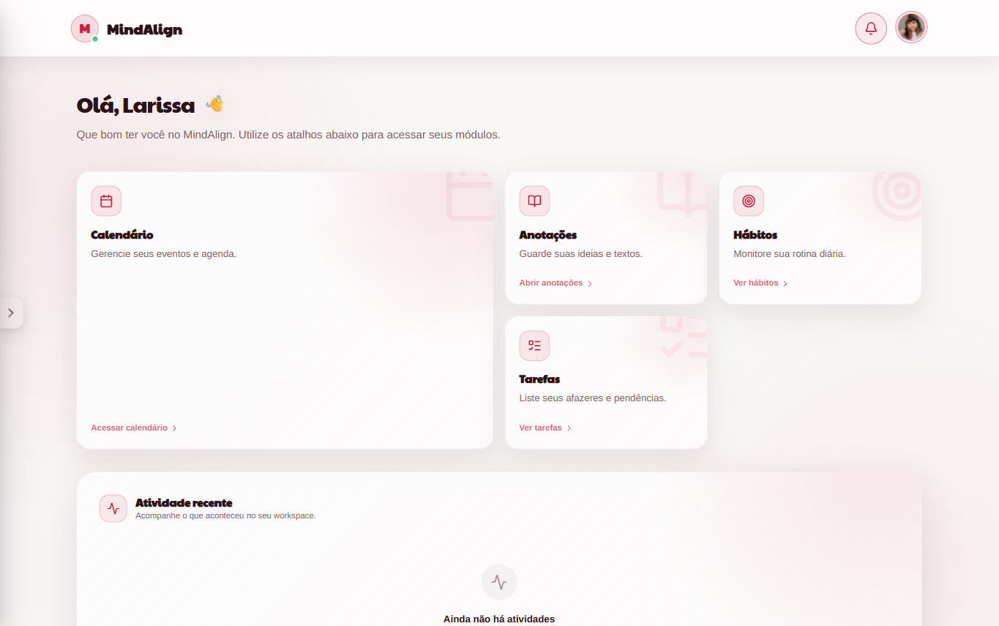
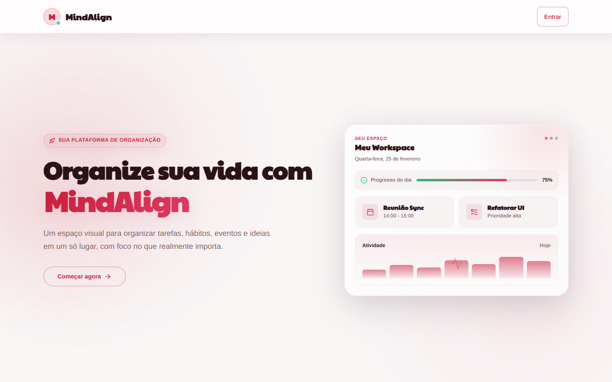
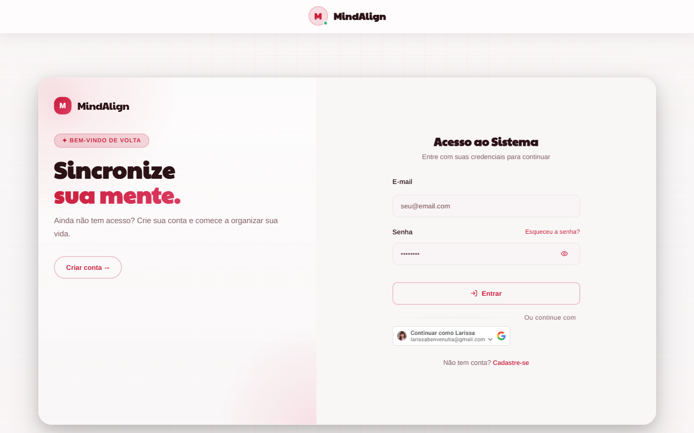
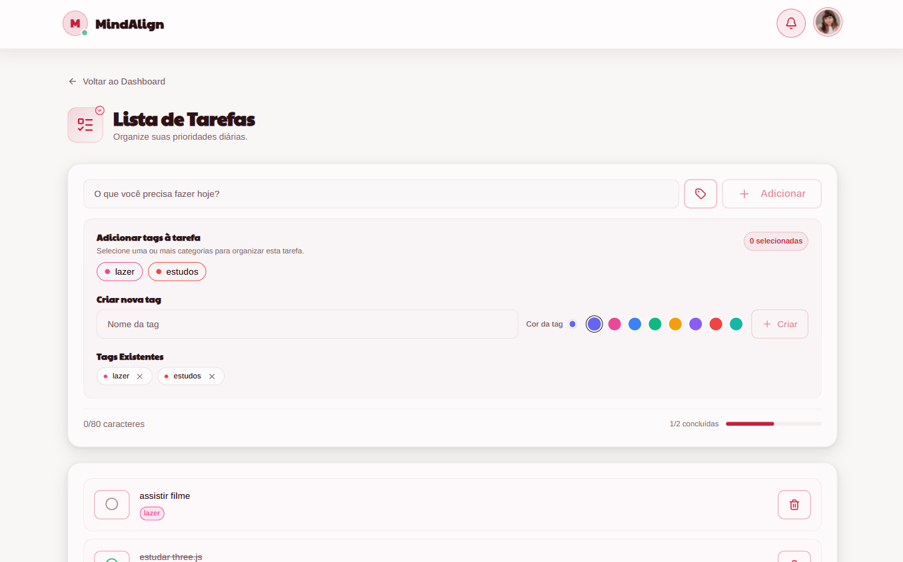
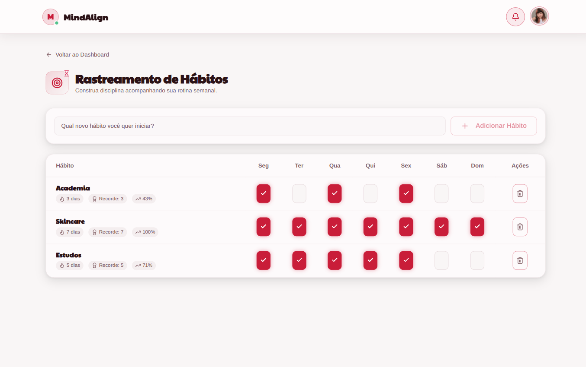
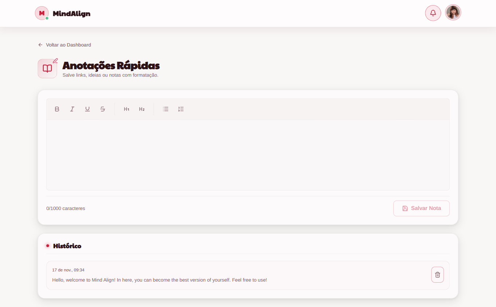
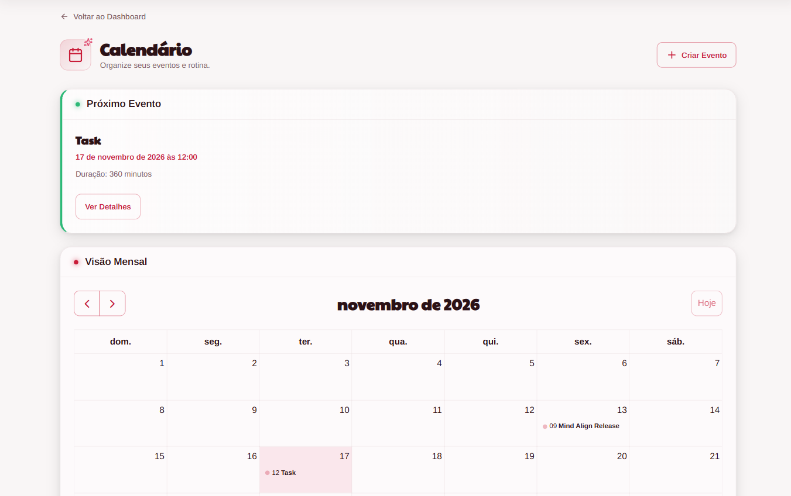
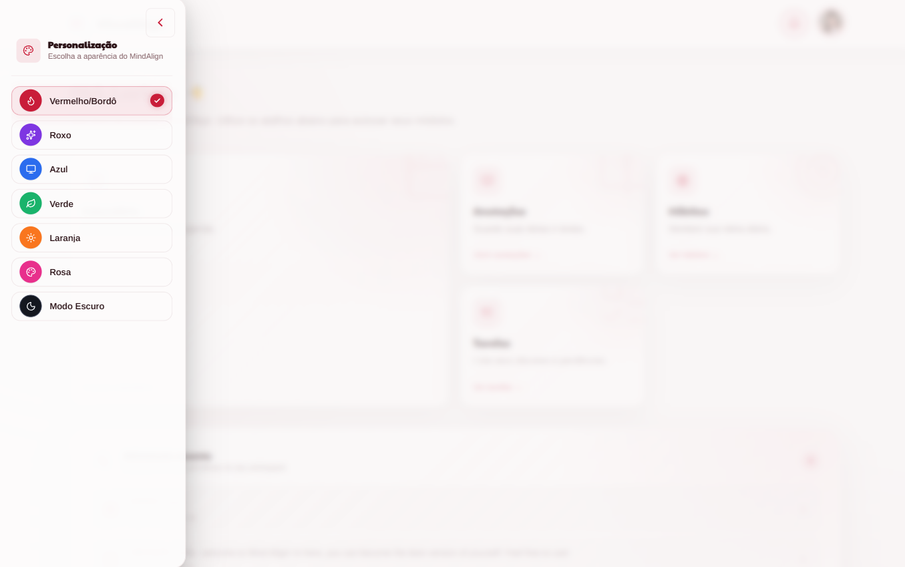
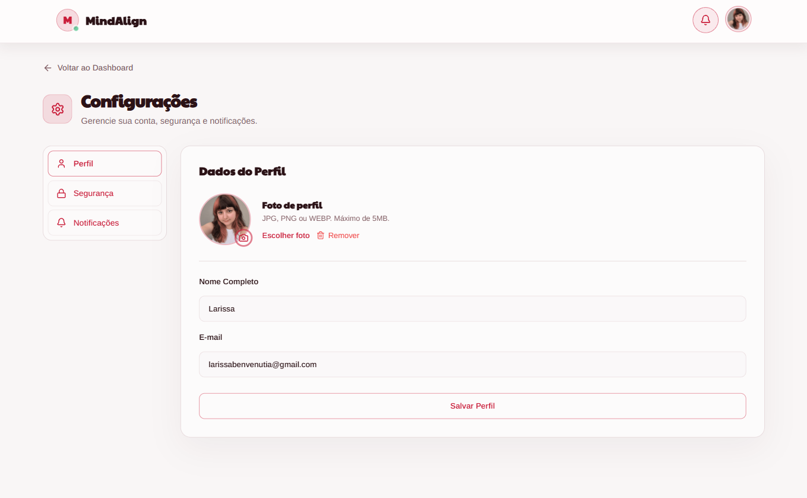

<div align="center">

# 🧠 Mind Align — Frontend

**A personal planner that brings tasks, habits, notes and calendar into one focused workspace.**


[🌐 Live demo](https://mind-align-app.vercel.app) · [⚙️ Backend repository](https://github.com/larissabenvenuti/Mind-Align-BackEnd)

</div>



## ⚡ At a glance

- **Problem:** productivity tools are scattered: one app for tasks, another for habits, another for notes.
- **Solution:** a single planner where every area shares one account, one theme and one dashboard.
- **My role:** UI design and front-end development, integrated with a custom REST API.

## ✨ Features

| Area | What you can do |
|---|---|
| 🔐 **Authentication** | Secure sign-up and login, plus sign-in with Google |
| 🏠 **Dashboard** | Interactive overview with the most recent activity logs |
| ✅ **Tasks** | Track completed-task progress and organize with custom tags like *college*, *family* or *work* |
| 🔁 **Habit tracker** | See progress by marked days, your record streak and percentage completion |
| 📝 **Notes** | Rich-text editor powered by Tiptap |
| 📅 **Calendar** | FullCalendar with the next upcoming event highlighted; add, edit and delete events, including several at once |
| 🎨 **Themes** | Switch the color theme across the private area |
| ⚙️ **Settings** | Change password, name and profile photo |
| 🔔 **Push notifications** | Enable push notifications and choose which ones to receive |

Everything you create can be deleted.

## 📸 Screens

| Landing page | Login |
|---|---|
|  |  |

| Tasks & tags | Habit tracker |
|---|---|
|  |  |

| Notes | Calendar |
|---|---|
|  |  |

| Themes | Settings |
|---|---|
|  |  |

<!--
📸 PRINTS A TIRAR (salvar em docs/screenshots/):
- hero.png      → página pública completa
- auth.png      → login/cadastro mostrando o botão "Entrar com Google" e o feedback de força da senha
- tasks.png     → lista com 2-3 tags coloridas (faculdade, família, trabalho), barra de progresso e uma tarefa concluída
- habits.png    → tabela de hábitos com dias marcados, recorde e % de progresso (opcional: montagem com a versão mobile 390x844)
- notes.png     → editor aberto com texto formatado (negrito, lista, sublinhado)
- calendar.png  → visão de mês com vários eventos e o card do evento mais próximo
- themes.png    → montagem lado a lado do mesmo painel em 2 temas de cor diferentes
- settings.png  → tela de configurações com alteração de senha, nome, foto e preferências de notificação
-->

## 🏗️ Technical highlights

- **Next.js App Router** with `middleware.ts` guarding private routes before they render.
- **Feature-based structure** (`auth`, `tasks`, `habits`, `notes`, `calendar`, `settings`) with shared `context`, `hooks`, `lib` and `types`.
- **Responsive by component:** the habit tracker renders as a table on desktop and as a list on mobile, instead of just shrinking.
- **SCSS Modules** for scoped styles, with a theming system that recolors the whole private area.
- **Tiptap** for the notes editor and **FullCalendar** for scheduling.

## 🛠️ Run locally

```bash
git clone https://github.com/larissabenvenuti/Mind-Align-FrontEnd.git
cd Mind-Align-FrontEnd
npm install
```

Create a `.env.local` file in the project root:

```env
NEXT_PUBLIC_API_URL=http://localhost:3333
NEXT_PUBLIC_GOOGLE_CLIENT_ID=your-google-client-id
NEXT_PUBLIC_VAPID_PUBLIC_KEY=your-vapid-public-key
```

Then start the app (the [backend](https://github.com/larissabenvenuti/Mind-Align-BackEnd) must be running):

```bash
npm run dev
```

Open http://localhost:3000.

### 🔑 Where to get the keys

<details>
<summary><b>Google Client ID</b> (Google sign-in)</summary>

1. Open the [Google Cloud Console](https://console.cloud.google.com/) and create or select a project.
2. Go to **APIs & Services → Credentials → Create credentials → OAuth client ID**.
3. Choose **Web application** and add `http://localhost:3000` under *Authorized JavaScript origins* (add your production URL too).
4. Copy the generated **Client ID** into `NEXT_PUBLIC_GOOGLE_CLIENT_ID`. The backend uses the same ID to verify tokens.

</details>

<details>
<summary><b>VAPID public key</b> (push notifications)</summary>

VAPID keys identify your server to the browser's push service. Generate a pair once:

```bash
npx web-push generate-vapid-keys
```

The command prints a **Public Key** and a **Private Key**:

- Put the **public** key in `NEXT_PUBLIC_VAPID_PUBLIC_KEY` (this repo).
- Put **both** keys in the backend `.env`, as described in the [backend README](https://github.com/larissabenvenuti/Mind-Align-BackEnd).

The public key must be identical on both sides. If you generate a new pair, users need to re-enable notifications. Never commit the private key. Push notifications only work on `localhost` or HTTPS.

</details>

## 🚧 Status

In active development. Quality is checked with ESLint and TypeScript; automated tests are not set up yet.

## 👩‍💻 Author & license

Built by **Larissa Benvenuti**. All rights reserved: no reuse license is granted.
